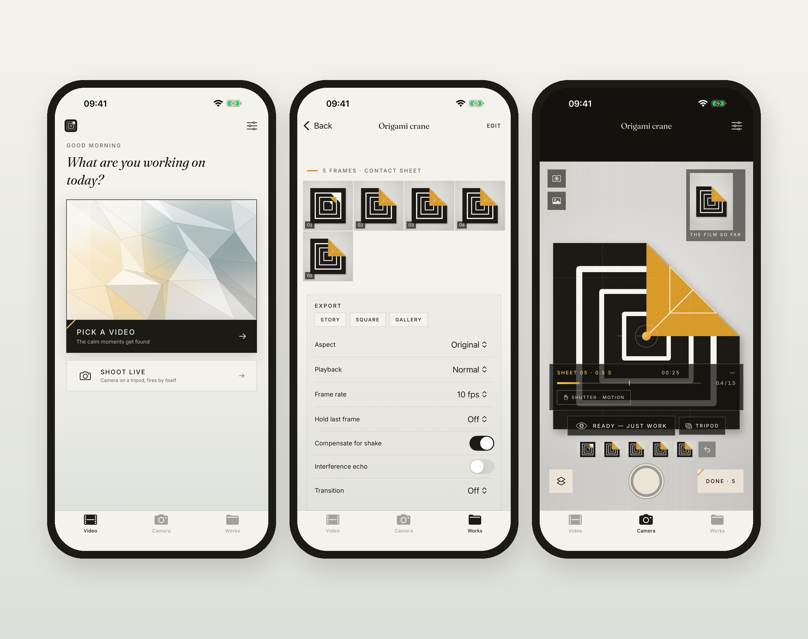
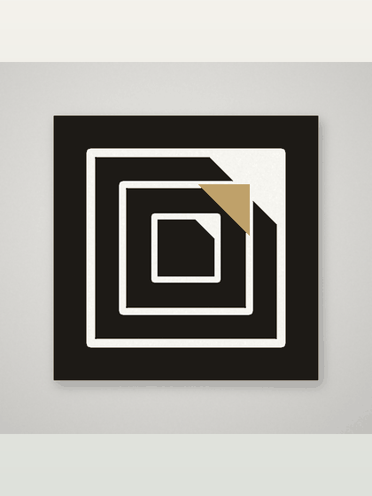
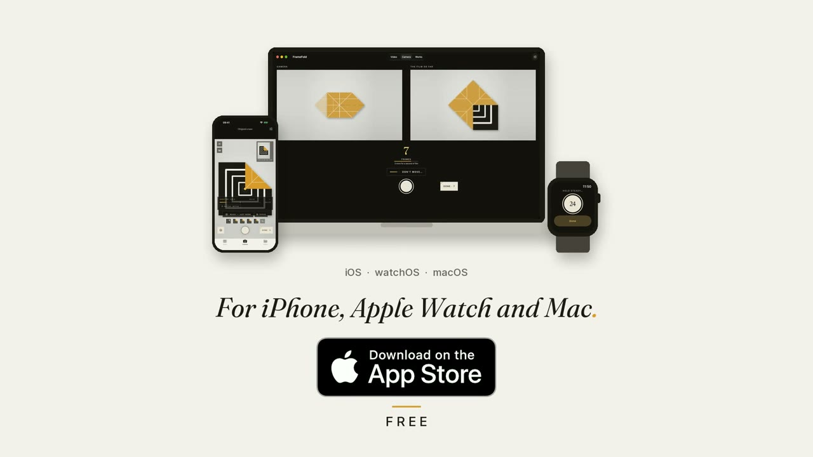
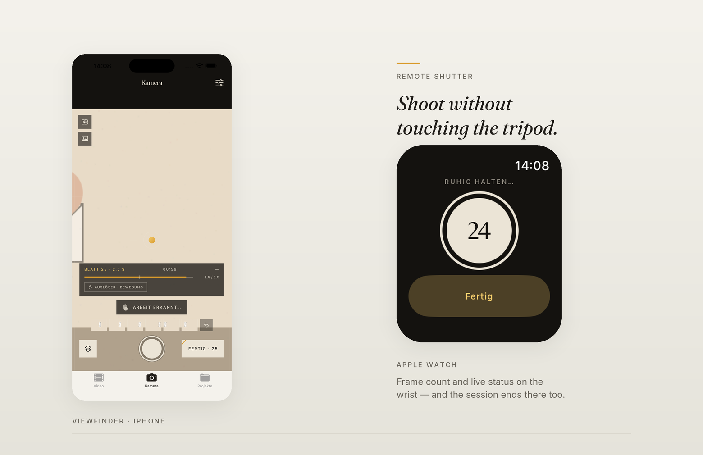

<div align="center">


# FrameFold

**A stop-motion camera for iPhone, iPad, Mac and Apple Watch. It shoots by itself once your hands are out of the frame.**

[](https://apps.apple.com/app/id6801045603)

[](https://github.com/RainerBracharz/framefold/actions/workflows/ios-build.yml)
&nbsp;·&nbsp; Free on the App Store &nbsp;·&nbsp; 17 languages &nbsp;·&nbsp; SwiftUI &nbsp;·&nbsp; iOS 17+

</div>

<div align="center">

</div>

<div align="center">

<br/><sub><em>The fold from the spot in stop-motion rhythm. Paper and fold are generated in code.</em></sub>
</div>

<div align="center">
<a href="docs/spot/framefold-spot-en.mp4"></a>
<br/><sub><em>The spot (29 seconds, with sound). Archive material: “Learning to Set Type” (1959, Prelinger Archives) and “Black and White Rag” (George Botsford, Edison 1913), both public domain via archive.org.</em></sub>
</div>

---

## Background

The Austrian artist **[Aldo Tolino](https://www.aldotolino.com/)** folds printed photographs into objects and photographs them again. He wanted to document that process without interrupting it for every frame.

FrameFold started as a tool for him. It finds the moments of rest in a video, drops every frame that shows hands, steadies the rest and assembles an animation. Later it became a camera that does the same while you work, and a public app for artists, craftspeople, teachers and students.

Why a consultancy publishes an app for a small audience is written up on [bracharz.com](https://www.bracharz.com/nischen-app-marketing/) (German).

## What it does

### Shooting

- **Auto-shutter.** Put the device on a tripod and work. The camera fires when your hands have left the frame and the scene is still. Exposure and white balance stay locked between frames, and the shutter speed follows the mains frequency so LED light does not flicker.
- **Focus by measured sharpness.** Focus locks once sharpness has peaked and refocuses if it drops. A frame that is not sharp does not enter the work.
- **Other triggers.** Tap, interval, clap, three-second self-timer, headphone volume buttons, Bluetooth remotes and the Apple Watch.
- **Onion skin.** The previous frame or the first frame of the session lies over the viewfinder at adjustable opacity. A reference image can be added.
- **Camera control.** Full sensor resolution, lens choice, manual ISO, shutter, focus and white balance.
- **Fold guide.** Printable crease patterns for Hypar, circular pleat and Miura-ori with mountain and valley folds. The pattern can follow the flat sheet in the viewfinder and shows the next fold with every frame. Hypar and circular pleat follow the Origami Simulator by Amanda Ghassaei, created with Erik Demaine and Tomohiro Tachi.

### From a video

- **Video to stop-motion.** FrameFold samples the footage, scores motion and sharpness and keeps one frame per moment of rest.
- **Hands removed.** Frames with visible hands are dropped, using Apple's Vision hand pose detection and person segmentation.
- **Review.** All candidate frames appear as a contact sheet. Tap to deselect, change the yield with a slider, play the selection as a loop.

### Editing and sound

- **Frames.** Duplicate, hold, reorder, reshoot a single frame, restore from a 30-day trash, undo.
- **Sound.** Several audio tracks, music from a file, voice recording while the film plays, ten sound effects synthesised in code and typed text spoken by an on-device voice.
- **Text and drawing.** Titles, credits, text, speech bubbles and drawings across as many frames as needed.
- **Green screen and camera moves.** Key out green or blue against an image or a movie. Pan and zoom across a range of frames.
- **Export.** 2 to 30 fps, up to 4K, HEVC or ProRes, image sequence, no watermark.
- **Paper.** Every work can be printed as a contact sheet or as a flip book with cut lines and a binding edge.
- **Work as a file.** A work can be passed on by AirDrop or Files and opened on another device.

### Studio

On Mac and iPad, and on iPhone if switched on, the camera becomes a stop-motion workspace: viewer with live and captured toggle, multi-frame onion skin, difference and clipping views, aspect masks, timeline with loop marks and notes, focus loupe, a watched camera folder for DSLR and mirrorless cameras (RAW included), USB tethering on the Mac, time-lapse, and an X-sheet with Preston Blair mouth shapes. Lights can be driven over Art-Net and motion control over Bluetooth. Guide and key map: [docs/studio](docs/studio/README.md).

An external display over HDMI or AirPlay shows the camera feed and the growing film without controls.

<div align="center">

</div>

### School

- A two-lesson plan and a Hypar lesson with printable templates (German, CC BY 4.0): [docs/unterricht](docs/unterricht/README.md)
- A privacy fact sheet for schools (German): [docs/schule](docs/schule/README.md)
- Press kit: [docs/presse](docs/presse/README.md)

## Three modes

| Mode | For |
|---|---|
| **Simple** | Pick a video or shoot, get a stop-motion. Large counter, few controls. |
| **Advanced** | Frame rate, aspect, resolution, playback mode, stabilisation, studio. |
| **Atelier** | Everything, plus print look, paper relief, image echo and fold transitions. |

## Data

FrameFold has no account, no server and no analytics. It makes no connection to the internet. Art-Net on the local network and Bluetooth motion control connect only when switched on. The microphone is used for voice recording and clap trigger. Speech recognition and text to speech run on the device. [Privacy policy](https://www.bracharz.com/framefold-datenschutz/)

## How it works

```
Video ─▶ sample ~10 fps ─▶ motion + sharpness scoring ─▶ Otsu rest detection
      ─▶ hand removal (Vision) ─▶ dedup ─▶ review ─▶ stabilise
      ─▶ assemble (AVAssetWriter)
```

Rest detection, sharpness, perceptual hashing, crop geometry and shift estimation sit in one file without framework dependencies (`FrameFold/Algorithms.swift`). It has its own tests that run without Xcode.

## Design

The visual language follows Tolino's 2024 series: crushed white paper on gradient fields, with amber as a signal colour. The home screen shows a fractured paper field filled with the frames of the latest work, and the light moves across the facets when the device is tilted.

Typography pairs **Fraunces** with **Inter**. Selection is marked by inversion. The mark is a sheet whose folded corner contains a sheet, three times over.

## Engineering

| | |
|---|---|
| **UI** | SwiftUI (iOS 17+), watchOS 10+ companion, Mac Catalyst |
| **Capture and vision** | AVFoundation, Vision, CoreMotion, Core Image, ImageCaptureCore |
| **On-device ML** | Apple Vision hand pose and person segmentation, no custom model |
| **Persistence** | File-based projects with JSON manifests |
| **CI/CD** | GitHub Actions builds and tests every push. fastlane uploads, submits and releases. |
| **Tests** | Unit tests for the algorithms, the project store and the studio, plus a UI walkthrough that saves a screenshot of every screen per language |
| **Localisation** | String Catalog, German source, 16 translations |
| **Dependencies** | None |

## Build and run

1. Open `FrameFold.xcodeproj` in Xcode.
2. Select your team under **Signing & Capabilities**.
3. Connect an iPhone and press **⌘R**.

The app is free on the [App Store](https://apps.apple.com/app/id6801045603).

## Licence

The source code is published for reading. It is under a proprietary licence, see [LICENSE](LICENSE). The teaching material in `docs/unterricht` is under CC BY 4.0.

Typefaces: [Fraunces](https://github.com/undercasetype/Fraunces) and [Inter](https://github.com/rsms/inter), both under the SIL Open Font License (see `FrameFold/Fonts-Licenses/`).

Built by **[Bracharz Consulting](https://www.bracharz.com)**, Rainer Bracharz, with AI assistance. The first version was a commission for **[Aldo Tolino](https://www.aldotolino.com/)**.

---

© 2026 Bracharz Consulting. Artwork and process shown belong to Aldo Tolino.
